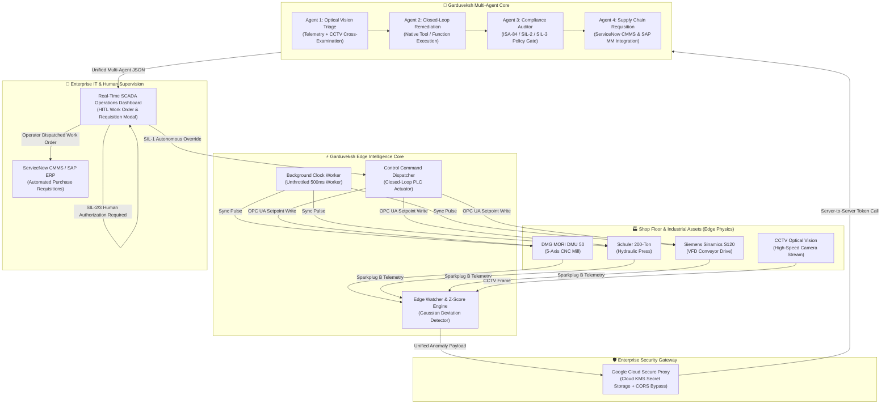

# 🏭 Garduveksh — Autonomous Industrial Edge AI Suite

> **Autonomous Industrial IoT (IIoT) Digital Twin & Multi-Agent Closed-Loop SCADA Remediation Suite**  
> Powered by Edge Neural Architectures, Google Cloud Platform, and Industrial Control Systems.

[]()
[]()
[]()
[]()

---

## 🌟 Executive Summary

Industrial downtime costs Global 2000 manufacturers over **$50 billion annually**. When critical assets—such as 5-axis CNC machining centers, 200-ton hydraulic stamping presses, or automated conveyor lines—suffer mechanical degradation, human operators typically discover the failure only after catastrophic downtime has already occurred.

**Garduveksh** bridges the gap between OT (Operational Technology) and enterprise IT. It operates as an **Autonomous Edge AI Co-Pilot** that:
1. **Monitors real-time Sparkplug B / OPC UA telemetry** across digital twin physics simulations with first-order lag curves.
2. **Triages anomalies in real-time** using rolling Gaussian Z-score deviation analysis.
3. **Cross-examines multimodal sensor data with CCTV camera feeds** using **Edge Optical Vision**.
4. **Executes closed-loop setpoint overrides** autonomously for operational drift via native tool calling.
5. **Enforces ISA-84 / IEC 61511 Safety Instrumented System (SIS) gates** to guarantee human authorization for SIL-2/SIL-3 decisions.
6. **Autonomously drafts CMMS Work Orders & SAP Purchase Requisitions** (BOM part numbers, supplier lead times, and vendor PO emails) when hardware lockouts occur.

---

## 📐 Enterprise Architecture



---

## 🚀 Key Technological Innovations

### 1. Unified 1-Shot Multi-Agent Synthesis (~2s Latency)
Traditional AI workflows chain multiple LLM calls sequentially, incurring 10–15 seconds of latency that violates industrial reaction time requirements. Garduveksh uses a **single-pass unified inference pipeline** that synthesizes Triage, Remediation, Safety Governance, and Procurement in **under 2.5 seconds**.

### 2. Multimodal Optical Cross-Examination (Zero-Cheat Vision)
The system does not rely on numerical sensors or prompt text hints. When an anomaly triggers, the Edge Gateway captures a live optical CCTV camera frame (Base64 JPEG) and feeds it to the vision intelligence engine. The neural core cross-examines vibration, pressure, and thermal numbers purely against optical symptoms (e.g. spindle thermal blueing, hydraulic fluid atomization, conveyor belt smoke) directly from pixels.

### 3. Native Gemini Tool Calling (Official Function Declarations)
Zero regex, zero string parsing, and zero simulated JSON flags. Remediation decisions are driven strictly by official Gemini Function Declarations (`tools: [{ functionDeclarations }]`). The agent outputs genuine `functionCall` objects (`adjust_setpoint` and `initiate_maintenance_lockout`) with strictly typed arguments verified against industrial parameters.

### 4. Grounded OEM Maintenance Manuals & Parts Catalog (RAG)
Procurement requisitions are never hallucinated. The procurement agent is grounded against authentic manufacturer maintenance and overhaul manuals (`manuals/oem_parts_catalog.json`). Work orders automatically cite verified OEM manual chapters, authentic SKUs (e.g., `SKF-7014-CD/P4ADGA`, `PARKER-PK-350-B90-V`, `GATES-POLYC-8MGT-1200`), manufacturer installation torque specs (Nm), and certified technician credentials.

### 5. Zero-Leak Secret Architecture (Serverless Gateway)
No API keys are exposed to the browser. Telemetry requests pass through an authenticated serverless Google Cloud proxy. All API keys and secrets are locked inside Google Cloud Script Properties (KMS), protecting production quotas against unauthorized web scraping.

### 6. Background Tab Resilience (Web Worker Clock)
Modern browsers aggressively throttle `setInterval` on inactive tabs down to 1Hz, causing traditional web-based digital twins to stutter and desync. Garduveksh uses a dedicated **HTML5 Web Worker (`BackgroundClock`)** that maintains uninterrupted 500ms physics ticks even when operators switch tabs.

---

## 📋 Architecture & Deployment Scope

> [!NOTE]  
> **Evaluation Work Cell Configuration:**  
> In this release, industrial machines (DMG Mori CNC Mill, Schuler Press, Siemens Sinamics VFD) and CCTV camera feeds run in high-fidelity mathematical digital twins using first-order lag curves ($\tau$) and Gaussian noise models.  
> In enterprise plant deployment, this Edge Gateway connects directly to physical Siemens S7-1500 / Allen-Bradley ControlLogix PLCs via Modbus TCP and OPC UA, routing telemetry to Google Cloud Pub/Sub and Vertex AI as depicted in the enterprise roadmap.

---

## 🎮 Step-by-Step Operator Demo Walkthrough

### Step 1: Launch the Operations Dashboard
Open `index.html` in any modern web browser.
1. Click **Start Machine** on `DMG_MORI_DMU_50`.
2. Expand the detail drawer. Observe the live **CCTV Optical Inspection** camera monitor and the real-time smooth Bezier telemetry charts.

### Step 2: Test Closed-Loop Autonomous Healing (Tier 1 Drift)
1. Click **Simulate 2-Hour Time Skip**.
2. **Physical Symptom:** Coolant flow experiences mechanical delivery restriction, dropping to ~28 L/min.
3. **AI Response:** 
   - The intelligence core detects the statistical dip and verifies the coolant nozzle envelope via optical inspection.
   - The agent issues a native `adjust_setpoint` function call to overdrive the pump to 50 L/min.
   - The closed-loop controller fights the restriction and stabilizes the process variable back to the nominal 40 L/min.
   - Phase 3 Governance identifies this as a SIL-1 action and permits autonomous execution.

### Step 3: Test Catastrophic Failure & Procurement Agent (Tier 2 Lockout)
1. Click **Simulate 8-Hour Time Skip**.
2. **Physical Symptom:** Spindle bearing rupture causes vibration to spike above 4.5 mm/s (ISO 10816-3 Zone D).
3. **AI Response:**
   - Optical camera highlights severe thermal blueing and metal debris.
   - The agent invokes `initiate_maintenance_lockout`.
   - Phase 3 Governance enforces ISA-84 protocols: halts autonomous control and flags that **Supervisor Authorization is Mandatory**.
   - The Autonomous Procurement Agent dynamically synthesizes a complete **ServiceNow Work Order & SAP Purchase Requisition** grounded in OEM manuals.
4. **Human-in-the-Loop Review:**
   - A deep red alert banner appears: **"CMMS Work Order & Requisition Required"**.
   - Click **Review & Approve Procurement PO** to open the interactive modal.
   - Inspect the live AI-generated Bill of Materials (BOM) with authentic SKF part numbers (`SKF-7014-CD/P4ADGA`), supplier lead times, installation torque specs (`65.0 Nm`), technician certifications, and the drafted SAP vendor email.
   - Click **Approve Requisition & Execute Lockout** to safely lock out the asset and dispatch the purchase order.

---

## 🛠️ Project Structure

```text
├── agent/
│   ├── agent.js              # Multi-Agent Core (Native Gemini Function Calling & Grounded RAG)
│   ├── clock_worker.js       # Background Web Worker (Zero tab freezing)
│   ├── cctv_engine.js        # Industrial CCTV optical inspection camera engine
│   ├── watcher.js            # Edge Gateway (Rolling Z-score anomaly detector)
│   └── dashboard_bridge.js   # Client bridge & machine driver dispatcher
├── assets/
│   └── cctv/                 # Photorealistic optical inspection frames & thumbnails
├── manuals/
│   └── oem_parts_catalog.json # Grounded OEM manuals, SKUs, and overhaul procedures
├── machine/
│   ├── DMGMori_CNC.js        # 5-Axis CNC Mill simulator (Lag physics & wear)
│   ├── Schuler_Press.js      # Hydraulic Press simulator (Pressure & thermal creep)
│   └── Siemens_VFD.js        # VFD Conveyor simulator (Inrush current & jams)
├── config.js                 # Proxy endpoint & security token configuration
├── index.html                # High-density industrial SCADA operator dashboard
├── app.js                    # UI state management & chart animations
├── machine_registry.json     # ISA-84 SIL governance context & tag specifications
└── README.md                 # Project documentation
```

---

## 🔒 Security & Secret Management

- **API Key Sanitization:** Zero API keys are hardcoded in frontend or backend code.
- **Serverless Gateway:** All intelligence core interactions route through a Google Cloud Web App backed by Cloud KMS (`Script Properties`).
- **CORS Protection:** All client payloads are signed with an internal application verification token and transmitted as CORS Simple Requests (`text/plain;charset=utf-8`).

---

## 👥 Authors & Team

Developed for the **AI Builder Cup** using Google Cloud Platform and Gemini Edge Intelligence.
Licensed under the Apache 2.0 License.
